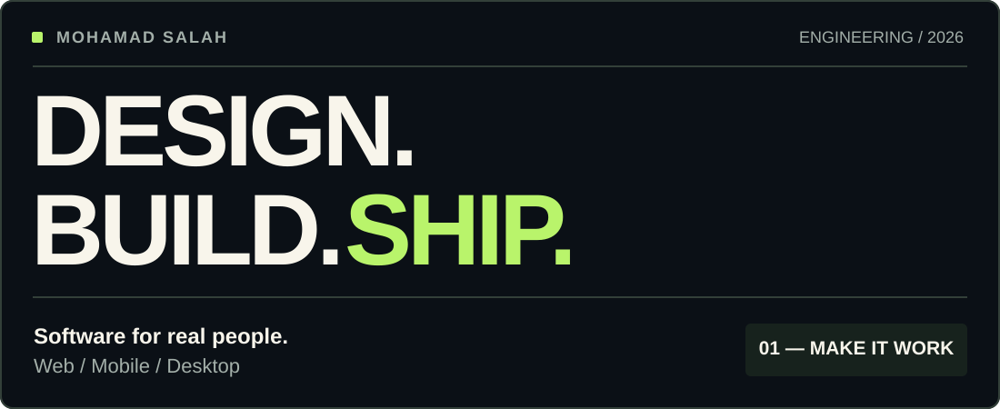
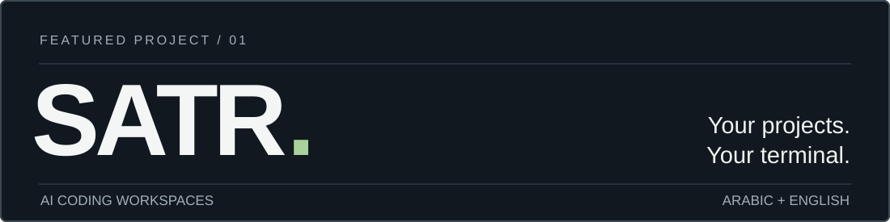

<picture>
  <source media="(prefers-color-scheme: dark)" srcset="./assets/hero-dark.svg">
  <source media="(prefers-color-scheme: light)" srcset="./assets/hero-light.svg">
  
</picture>

I’m **Mohamad**, a software engineer building focused, reliable products across web, mobile, and desktop. I care about interfaces that feel intuitive, robust application behavior, and making software work well in **Arabic and English**.

**[Portfolio ↗](https://mohamadsala.me/en)** &nbsp;·&nbsp; **[LinkedIn](https://www.linkedin.com/in/mohamad-salah-4a6ab93a9/)** &nbsp;·&nbsp; **[Email](mailto:MohamadSalah@tuta.io)**

### Featured / Satr

**[Satr →](https://github.com/Mo999salah/Satr)** — A terminal workspace for AI coding tools, built with first-class support for Arabic and mixed-direction text.

### Elsewhere in my work

**[Racio ↗](https://github.com/Mo999salah/Racio)** — Privacy-conscious personal finance, from statement review to budgets and savings goals.

**[Wali ↗](https://github.com/Mo999salah/wali)** — A lightweight, Linux-native desktop experience for WhatsApp Web.

More projects are pinned below ↓

---

**Things I work with** &nbsp; React · Next.js · TypeScript · React Native · Desktop apps · Linux

Based in Istanbul, Türkiye · [mohamadsala.me](https://mohamadsala.me/en)
